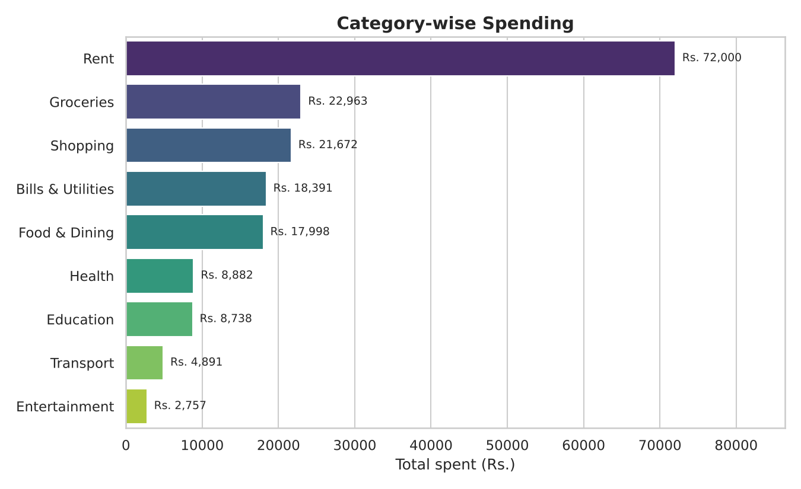
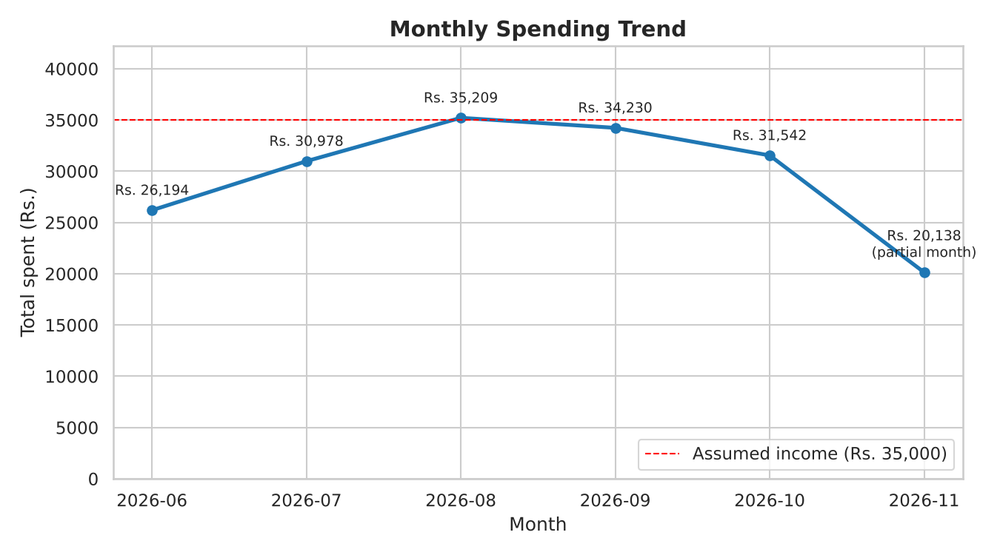
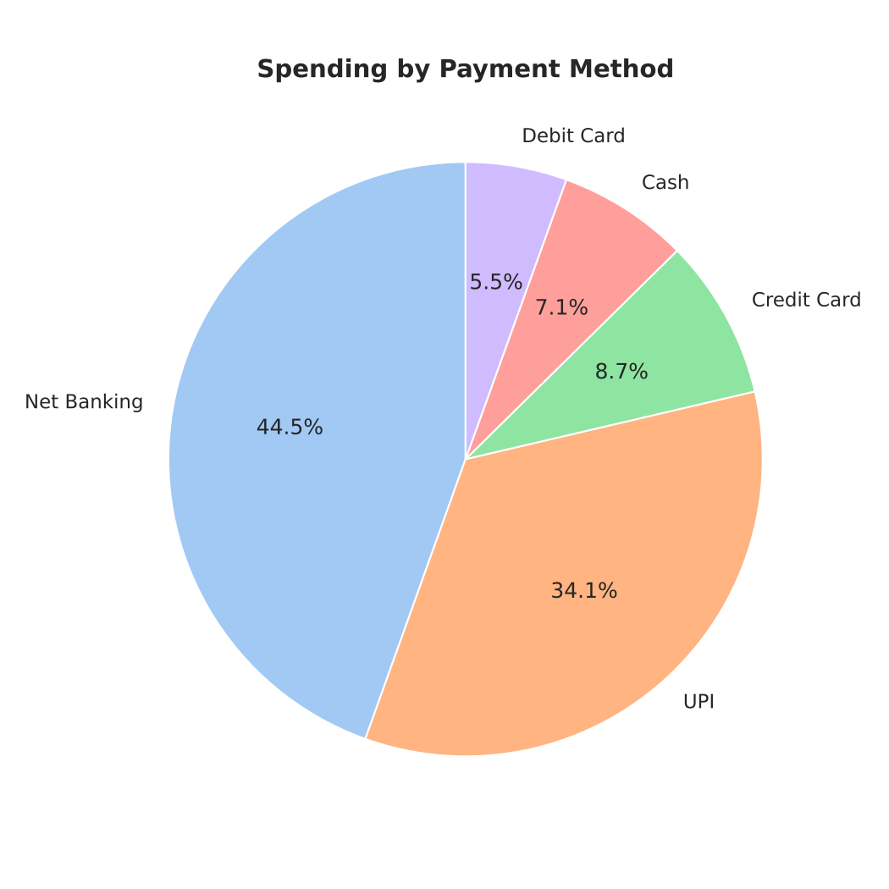
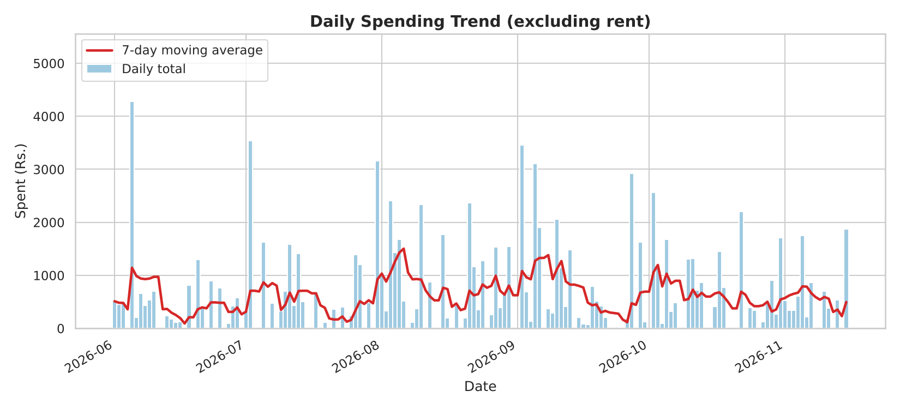

# Personal Expense Tracker with Data Visualization

A beginner-friendly Python project that loads expense data, cleans it, analyses
spending by category, month, payment method and day, draws charts and writes a
summary report. An optional Streamlit dashboard shows the same results in the browser.

> All data in this repository is **synthetic** (generated by the code). No real bank data is used.

## Problem statement

Many people spend money without knowing where it goes. Bank statements are long,
messy and inconsistent, so it is hard to see habits, overspending or savings.
This project turns a raw expense list into clear numbers, charts and plain-English insights.

## Industry relevance

Expense and budgeting analytics are core features of personal-finance and fintech apps.
The same skills are used in data analyst, business analyst, finance-analytics and
Python automation roles: **data cleaning, aggregation, KPI design, visualization and reporting**.

## Features

- Generates a realistic synthetic dataset (6 months) with deliberate "dirty" rows
- Data cleaning with a log: invalid rows, spelling fixes, missing values, duplicates
- Category-wise, monthly, payment-method and daily analysis
- Highest spending category, average daily spending, savings per complete month
- Detects **partial months** so an unfinished month is not compared unfairly
- Monthly **budget alerts** per category
- 4 charts (bar, line, pie, daily trend with 7-day moving average)
- CSV tables and a text summary report
- Optional Streamlit dashboard with upload and filters
- Unit tests for cleaning and analysis

## Tech stack

Python 3 | Pandas | NumPy | Matplotlib | Seaborn | CSV | Streamlit (optional) | pytest (optional)

Tested with Python 3.12, pandas 3.0, matplotlib 3.11, seaborn 0.13.

## Folder structure

```
Personal-Expense-Tracker-Visualization/
├── data/            expenses.csv (synthetic input data)
├── notebooks/       space for exploration notebooks
├── src/             all project code
│   ├── config.py          paths, categories, budgets, income
│   ├── data_generator.py  creates synthetic data (with messy rows)
│   ├── data_loader.py     loads and cleans the CSV
│   ├── analysis.py        all calculations
│   ├── visualize.py       the 4 charts
│   └── report.py          CSV tables and text report
├── tests/           pytest tests
├── outputs/         generated CSV summary tables
├── images/          generated chart PNG files
├── reports/         generated summary_report.txt
├── docs/            architecture notes
├── app_streamlit.py optional dashboard
├── main.py          runs the whole pipeline
├── requirements.txt
├── .gitignore
└── README.md
```

## How to run

```bash
# 1. Get the code
git clone <your-repo-url>
cd Personal-Expense-Tracker-Visualization

# 2. Create and activate a virtual environment
python -m venv .venv
.venv\Scripts\activate          # Windows
source .venv/bin/activate       # Mac / Linux

# 3. Install libraries
pip install -r requirements.txt

# 4. Run the pipeline
python main.py
```

Other options:

```bash
python main.py --regenerate           # create a fresh synthetic dataset first
python main.py --csv path/to/my.csv   # analyse your own file
streamlit run app_streamlit.py        # optional dashboard
python -m pytest                      # run the tests
```

**Your own CSV** needs these columns: `date, category, amount, payment_method, description`.
Running with `--csv` overwrites the files in `outputs/`, `images/` and `reports/`.

## Sample output

From the included synthetic data (1 June to 15 November 2026):

```
KEY NUMBERS
  Total spending         : Rs. 178,291.07
  Number of transactions : 224
  Average daily spending : Rs. 1,061.26
  Highest category       : Rent (Rs. 72,000.00)

INSIGHTS
  - Rent is the biggest expense: Rs. 72,000 (40.4% of all spending).
  - Ignoring fixed rent, the biggest flexible spend is Groceries at Rs. 22,963.
  - Weekends cost more: Rs. 1,316 per day versus Rs. 959 on weekdays (37% higher).
  - 15 category-month(s) went over budget. The largest overspend was Shopping in 2026-09 by Rs. 3,709.
  - Best savings month: 2026-06 (Rs. 8,806 saved, 25.2% of income).
```

See the full report in [`reports/summary_report.txt`](reports/summary_report.txt).

## Screenshots

| Category-wise spending | Monthly spending trend |
|---|---|
|  |  |

| Payment methods | Daily spending trend |
|---|---|
|  |  |

## Assumptions and limitations

- Monthly income (Rs. 35,000) and category budgets are assumptions. Change them in `src/config.py`.
- Duplicate removal treats two rows with the same date, category, amount, method and
  description as one transaction. Two genuinely identical purchases on one day would be merged.
- Savings are only calculated for complete months.
- Educational project, not financial advice.

## Learning outcomes

- Cleaning messy real-world style data with Pandas
- Grouping and aggregating data (category, month, payment method)
- Time-based analysis and handling incomplete periods
- Building clear charts with Matplotlib and Seaborn
- Structuring a project into small, testable modules
- Writing tests and a GitHub-ready README

## Future improvements

Budget alerts by email, recurring-expense detection, bank statement import,
a simple category classifier, and multi-currency support.
